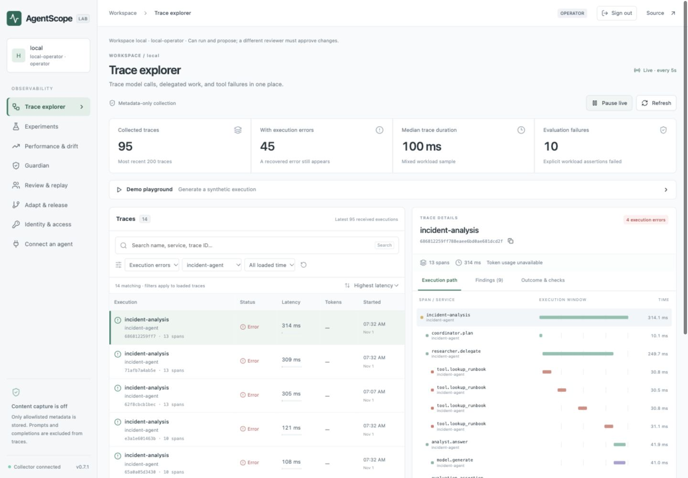
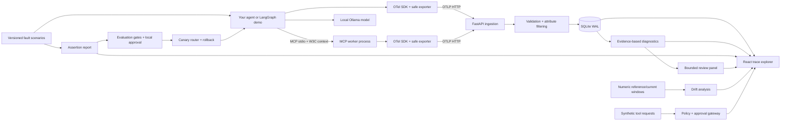

# AgentScope

**Observe agent behavior. Inspect the evidence. Control the change.**

[](https://github.com/Harsh-Dhingra/agentscope/actions/workflows/ci.yml)

AgentScope is a local-first observability and reliability lab for AI workflows. It accepts OpenTelemetry traces, reconstructs work across processes, flags evidence-backed failure patterns, compares implementations against a reproducible evaluation dataset, and exercises reviewed configuration rollouts.

Built with **Python · FastAPI · React · TypeScript · OpenTelemetry · LangGraph · MCP · SQLite**.

This is an independent engineering portfolio project. It is not affiliated with other projects named AgentScope. The current release is a local development system with credential-bound tenants and roles; production and multicloud requirements are documented explicitly.



## Why build this?

A successful HTTP request can hide a failed AI task. A workflow can use an obsolete runbook, retry a broken dependency repeatedly, or answer confidently after its evidence lookup fails.

AgentScope connects those behaviors to their execution traces and evaluates the actual outcome. Its demo workload is incident analysis, keeping the observability platform independent of any one customer-service use case.

## What works today

- **OTLP/HTTP ingestion:** protobuf and JSON traces, parent IDs, links, execution times, error status, resource metadata, and duplicate-delivery upserts.
- **Trace explorer:** searchable and paginated table, service/status/time filters, latency/token sorting, keyboard selection, persistent execution inspector, span waterfall, and pause/resume live refresh. Filters apply to the latest 200 loaded traces.
- **Source-side privacy controls:** bundled exporter drops unapproved attributes before network transport and suppresses raw exception messages. The collector filters incoming metadata again.
- **Real integrations:** a role-based LangGraph workload, a real MCP stdio worker with cross-process W3C trace propagation, and local Ollama inference with model-reported token counts.
- **Failure diagnosis:** failed steps, stale-evidence metadata, repeated calls, failed explicit assertions, and missing parent spans.
- **Reproducible experiments:** baseline versus controlled workflow for healthy execution, stale evidence, timeouts, and excessive retries.
- **Collected-trace monitoring:** explicit UTC windows, source execution links, duration/token/tool-error/retry distributions, and missing-data reporting. [Trace drift guide](docs/trace-drift.md).
- **Performance and drift:** numeric reference/current windows, KS effect sizes, permutation tests, multiple-test correction, and distribution charts. Seeded scenarios and a custom-window API.
- **Guardian:** deterministic tool policy, explicit demo approval, persisted decision ledger, and transactional idempotency for synthetic tools.
- **Review panel:** three bounded analyzers, span-linked evidence, visible disagreement, and abstention on missing evidence.
- **Developer replay:** reproduce built-in failures, inspect a corrected run, and enforce regression checks through a CLI/CI exit code.
- **Adaptation workflow:** version registry, server-computed gates, workload/config digest, explicit local approval, 20% fixture canary routing, promotion, and rollback on candidate failure.
- **Identity and access:** credential-bound tenant databases, four roles, revocable browser sessions, separate reviewer approvals, and tenant-scoped mutation audit records.
- **Durable export:** optional bounded SQLite outbox, restart recovery, retry/backoff, quarantine, and delivery counters. [Run the outage/recovery example](docs/durable-delivery.md).
- **Outbox maintenance:** preview-first quarantine recovery and expiry, stable batch IDs, stale-plan rejection, and transactional OS-actor audit. [Maintenance guide](docs/outbox-maintenance.md).
- **Local storage:** SQLite WAL. No hosted observability account or paid model API is required for the fixture demo.

The diagnosis rules do **not** constitute a general hallucination detector. The experiment uses four authored scenarios with deterministic responses. The Ollama path performs actual model inference and is labeled separately.

## Run locally

Prerequisites: Python 3.12+ and Node.js 22+. The exact tested dependencies are in `requirements.lock` and `web/package-lock.json`.

```bash
git clone https://github.com/Harsh-Dhingra/agentscope.git
cd agentscope
make setup
make init-access
make run
```

Open **http://127.0.0.1:8765** and sign in using the operator key from the private, ignored `data/access-keys.json` file. See [access control](docs/access-control.md) for reviewer login and credential management. Start with **Stale evidence → Baseline → Scripted fixture**. Then repeat with **With controls** and inspect the difference. The fixture mode requires no model download.

Without Make:

```bash
python3 -m venv .venv
.venv/bin/python -m pip install -r requirements.lock
.venv/bin/python -m pip install -e . --no-deps
npm --prefix web ci
npm --prefix web run build
.venv/bin/python -m agentscope.identity init
.venv/bin/python -m uvicorn agentscope.api:app --host 127.0.0.1 --port 8765
```

### Actual local inference

Install Ollama and download a supported local model during setup:

```bash
ollama pull qwen3:8b
```

With Ollama running locally, select **Local Ollama** in the dashboard. The model can also be configured using `AGENTSCOPE_OLLAMA_MODEL`; the default is `qwen3:8b`. Missing inference fails visibly; there is no scripted or hosted fallback.

For a deliberately offline runtime, configure the Ollama server with `OLLAMA_NO_CLOUD=1`, pre-download all dependencies/model weights, and test the whole deployment with outbound traffic blocked. This repository has not yet undergone a complete network-isolation audit. A successful local call alone does not prove zero egress.

### Cross-process MCP trace

Select **MCP · subprocess** and a healthy or stale-evidence scenario. The tool runs in a separate Python process and exports its server span back through OTLP/HTTP. The trace includes both `incident-agent` and `mcp-runbook-worker`.

The demo explicitly carries `traceparent` in its tool contract; it does not claim universal automatic MCP tracing. If the API uses a different port, set `AGENTSCOPE_DEMO_EXPORT_ENDPOINT` to its `/v1/traces` endpoint before starting it.

### Container

```bash
docker compose up --build -d
docker compose exec agentscope python -m agentscope.identity init
```

Read the generated `data/access-keys.json` inside the container privately to sign in. Never commit or share that file.

The published port is bound to host loopback. The image runs as a non-root user. The Compose configuration uses host Ollama when available. On Linux, a host Ollama bound only to `127.0.0.1` may not be reachable from the container; use the native setup for inference rather than broadly exposing the model server. Fixture runs and the MCP worker need no Ollama service.

## Instrument your own Python workflow

```python
import os
from agentscope.telemetry import create_tracer

tracer, provider, exporter = create_tracer(
    service="my-agent",
    endpoint="http://127.0.0.1:8765/v1/traces",
    export_token=os.environ["AGENTSCOPE_EXPORT_TOKEN"],
)

with tracer.start_as_current_span("agent.run"):
    with tracer.start_as_current_span(
        "tool.lookup", attributes={"tool.name": "lookup"}
    ):
        pass  # your operation

provider.shutdown()
```

Set `AGENTSCOPE_EXPORT_TOKEN` to a collector key, then run `python examples/instrument.py` with the API running. Standard OTLP exporters can also send protobuf/JSON to `/v1/traces`. Source-side filtering is guaranteed only for the bundled exporter; configure equivalent redaction in third-party instrumentation before sending data.

## Evaluation and verification

```bash
make test
make evaluate  # Set AGENTSCOPE_API_KEY to an operator key; API must be running
```

The latest recorded fixture comparison passed **1/4 baseline** and **4/4 controlled** scenarios. These are regression results over the defined dataset, not production reliability, generalized model accuracy, or measured business impact. Inspect [validation notes](docs/validation.md) and the [recorded experiment](docs/experiment.json).

See [review, replay and release controls](docs/review-and-release.md), the [phase changelog](CHANGELOG.md), and [drift and policy methods](docs/drift-and-policy.md) for statistical assumptions and the gateway’s exact enforcement boundary.

The suite checks source-side redaction, OTLP validation, idempotent ingestion, span parentage, error status, controlled retries, diagnosis, browser origin/host restrictions, a real MCP subprocess round trip, seeded distribution shifts, unauthorized tool denial, and concurrent approval idempotency, evidence abstention, stale-release rejection, canary promotion, automatic rollback, and CLI regression failure codes. CI builds the dashboard and container separately.

## Architecture



Read the [design decisions](docs/architecture.md), [privacy boundaries](docs/privacy.md), and [15-minute demo guide](docs/demo.md).

## Product scope and next phase

The first three milestones and phase 4a identity controls plus the phase 4b durable exporter are implemented locally. [The platform roadmap](docs/platform-roadmap.md) separates working features from the remaining enterprise work: enterprise SSO, collector retention and audit archival, held-out evaluation, and a tested hybrid deployment.

## Deliberate limits and next work

- Local credential registry and per-tenant SQLite files, without enterprise SSO or process/resource isolation. Do not expose this API publicly.
- Optional single-node exporter outbox with bounded admission and retry; no distributed broker, retention scheduler, or scalable analytical store. Queue-full exports fail explicitly; accepted batches require a functioning filesystem for durability.
- No deployed hybrid/multicloud topology. The HTTP exporter has an explicit remote opt-in; production would add a verified TLS deployment, managed identities, and network policy.
- No automatic model-cost estimates. The UI reports available token usage; local inference still consumes hardware and power.
- No measured debugging-time reduction, customer CSAT, or production savings. Those require a user study or deployment.
- The demo is a fixed role-based LangGraph workflow. It does not represent autonomous agents negotiating tasks with each other.
- Generalized grounding evaluation, larger held-out datasets, evaluator calibration, tenant resource quotas, and cost attribution are planned follow-ups.

## References

- [OpenTelemetry Python instrumentation](https://opentelemetry.io/docs/languages/python/instrumentation/)
- [OTLP specification](https://opentelemetry.io/docs/specs/otlp/)
- [W3C context propagation in OpenTelemetry](https://opentelemetry.io/docs/concepts/context-propagation/)
- [LangGraph](https://github.com/langchain-ai/langgraph)
- [MCP Python SDK](https://github.com/modelcontextprotocol/python-sdk)
- [Ollama chat API](https://docs.ollama.com/api/chat)

MIT licensed. Third-party dependencies retain their respective licenses.
